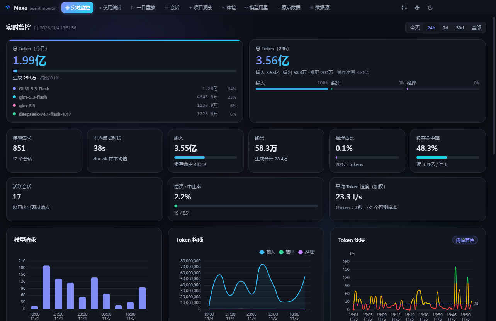
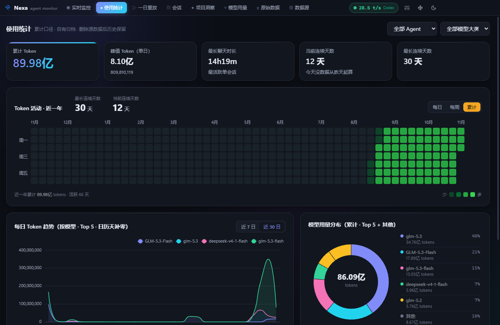
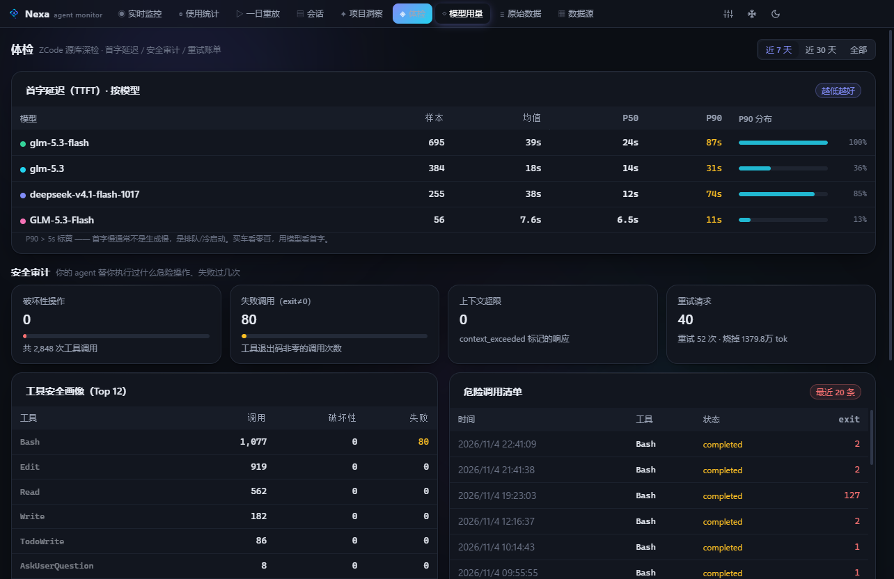

# Nexa — 通用 AI Agent 用量监控面板

> 一个纯本地的桌面仪表盘：只读解析各 AI coding agent 写在本地磁盘的会话数据，
> 把 **token 消耗**、**速度（TPS）**、**首字延迟**、**按模型 / 项目 / 工具的用量**
> 整理成可查、可追溯的界面。

**核心承诺：全程只读、全程离线。** 不修改任何 agent 的数据文件，不发起任何网络
请求 —— 它是观测器，不是代理。



## 为什么是 Nexa

现有的用量面板大多只回答"花了多少"。Nexa 想回答的是**"怎么花的、花得值不值"** ——
所以它在常规统计之外，做了几个没人做过的东西：

- **首字延迟（TTFT）体检** —— 慢的不是生成，是第一个字。按模型的 P50/P90 排行
- **急刹车指数** —— 你主动打断 agent 的比例与被打断烧掉的 token，按模型/时段分布
- **重试账单** —— 同一请求重发了几次、白烧了多少 token
- **安全审计** —— agent 替你执行过哪些破坏性操作、失败退出码清单
- **一日重放** —— 像看录像一样拖动时间轴，看某天的 token 按小时烧掉
- **项目排行榜 + 代码文件热点** —— 算力到底喂给了哪个项目、哪个文件
- **换角度**：自定义 agent 数据目录 —— 自写 agent 也能纳入统计

全部数据来自本机，全部计算在本地 worker 线程完成。

## 功能截图

| 使用统计（热力图 / 趋势 / 模型分布） | 体检（TTFT / 安全审计 / 重试账单） |
| --- | --- |
|  |  |

## 支持的 agent

| Agent | 状态 | 数据来源 | 验证方式 |
|---|---|---|---|
| **ZCode** | ✅ 完整支持 | `~/.zcode/cli/db/db.sqlite`（只读，`ZCODE_DB` 可改） | 本机实测（含对话重放） |
| **Codex**（OpenAI） | ✅ | `~/.codex/sessions/**/*.jsonl` + `archived_sessions`（`CODEX_HOME` 可改） | 本机实测 |
| **Claude Code**（Anthropic） | ✅ | `~/.claude/projects/<munged-cwd>/*.jsonl`（`CLAUDE_CONFIG_DIR` 可改） | 本机实测 |
| **MSAgent** | ✅ | `~/.ms-agent/sessions/*.jsonl`（`NEXA_MSAGENT` 可改） | 本机实测（meta/user/assistant/tool/usage 事件流） |
| **Gemini CLI** | ⚠️ 按源码格式实现 | `~/.gemini/tmp/*/chats/`（新旧两代格式） | 文档比对 |
| **Qwen Code（千问）** | ⚠️ | `~/.qwen/tmp/*/chats/`（`QWEN_HOME` 可改） | 文档比对 |
| **OpenCode** | ⚠️ v2 SQLite | `%APPDATA%/opencode/opencode.db` 等候选路径（`OPENCODE_DB` 可改） | 源码比对 |
| **pi**（badlogic） | ⚠️ | `~/.pi/agent/sessions/**/*.jsonl`（`PI_CODING_AGENT_DIR` 可改） | 官方文档比对 |
| **DeepSeek Harness (dsh)** | ⚠️ 防御式 | `~/.dsh/sessions/`（zstd 自动解压，`NEXA_DSH` 可改） | 待真实样例精调 |
| **workbuddy** | ⚠️ 防御式 | 候选目录探测（`NEXA_WORKBUDDY` 可改） | 待真实样例精调 |

⚠️ 标注的适配器按已知格式防御式解析：格式变化时自动降级为空，不影响其他
agent；装好对应 agent、数据目录出现后被自动探测并纳入统计。

### 自定义 agent

自写 agent 的数据目录无法自动探测 —— 在 **设置 → 自定义 agent** 里登记目录，
选择格式模板（通用 JSONL 自动识别 usage 字段，或复用 Claude Code / Codex /
Gemini / pi / MSAgent 的解析器）。支持目录递归扫描 `.jsonl / .json / .zst`。

## 快速开始

环境要求：**Node.js ≥ 22**、**pnpm ≥ 10**（Windows 10/11 x64）。

```bash
pnpm install     # 依赖（Electron 二进制走 .npmrc 里的国内镜像）
pnpm dev         # 开发模式（HMR）
pnpm typecheck   # 双 tsconfig 类型检查
pnpm build       # 构建三端产物到 out/
pnpm dist        # 打包 NSIS 安装包 → release/Nexa-Setup-*.exe
```

> `better-sqlite3` 会在 `postinstall` 时由 electron-builder 自动重编译为
> Electron ABI。首次拉取 Electron 二进制若超时，`.npmrc` 中的 npmmirror
> 镜像配置可直接生效（`electron_mirror`）。

打开后自动探测本机已安装的 agent，无需任何配置。所有数据只读，删掉来源数据
也不影响已归档的历史统计。

## 界面与快捷键

9 个页面：**实时监控 · 使用统计 · 一日重放 · 会话 · 项目洞察 · 体检 · 模型用量 ·
原始数据 · 数据源**。

| 操作 | 方式 |
|---|---|
| 切换页面 | **Ctrl+1 … Ctrl+9** |
| 命令面板（搜页面/会话/项目） | **Ctrl+K** |
| 深 / 浅主题 | 顶栏 🌙 或 **T** |
| 氛围光晕（Aurora） | 顶栏雪花按钮 |
| 设置（归档保留期 / 自定义 agent / 日报 / 归档合并） | 顶栏滑杆按钮 |

## 架构

```
src/
├── shared/                共享类型 + 类型化 API 契约
│   ├── types.ts           UsageRecord / SessionInfo / 聚合模型
│   └── api.ts             NexaApi —— 渲染端可见的全部能力
├── main/                  Electron 主进程
│   ├── index.ts           窗口（无边框 + 原生控制按钮）/ 设置 / IPC / 托盘日报
│   └── data/
│       ├── worker.ts      数据服务 worker 线程（RPC 宿主 + 2s 轮询 + 崩溃自愈）
│       └── store.ts       缓存库 + 增量扫描 + 二进制归档 + 全部查询
│   └── core/
│       ├── paths.ts       各 agent 目录解析（环境变量可覆盖）
│       ├── util.ts        行读取器 / 模型大类 / AGMON v2 归档二进制 IO
│       └── adapters/      zcode · codex · claude · geminiLike · opencode · pi
│                          + msagent · dsh · workbuddy · customAgent
├── preload/               contextBridge → window.nexa（sandbox + contextIsolation）
└── renderer/              React 界面（Tailwind 4 + ECharts 按需引入）
    ├── App.tsx            标题栏 / 导航 / 健康状态 / 实时胶囊 / 命令面板
    ├── components/        Chart · KpiCard · Heatmap · JsonView · CommandPalette …
    └── pages/             9 个页面
```

**数据流**：渲染端 → preload（contextBridge）→ 主进程 IPC → worker RPC → SQLite。
所有磁盘 IO / 解析 / 聚合都在 worker 线程内完成，主进程零阻塞；worker 崩溃时
主进程 1 秒内自动重启（最多 3 次），挂起的查询立即失败而非无限等待。

## 数据口径

- **一条记录 = 一次完成的模型响应**，带五类 token：输入 / 缓存读 / 缓存写 /
  输出 / 推理。总 token = 输入 + 输出 + 推理（缓存不计入总量）。
- **TPS =（输出 + 推理）÷ 流式秒数**，分层着色 <20 红 / 20–100 黄 / >100 绿；
  "加权平均" = Σ生成 token ÷ Σ可测秒数（不是逐条平均）。
- **时长可测性**：ZCode / Claude Code / OpenCode 有精确流式时长；Codex / pi /
  MSAgent 等用相邻响应间隔近似（界面标 ≈），相邻间隔 >120 秒视为不可测，
  <100ms 的单块响应不参与速度统计。
- **错误口径**：中止 / API 错误 / 取消各记一条零 token 错误记录（已消耗 token
  保留在统计里），错误率 = 错误 ÷ 总请求。
- **时间与"今天"**：按本地时区，日聚合对齐本地午夜。
- **模型大类**：模型名第一个 `-` 前的小写段（`GLM-5.3-Flash` → `glm`）。

## 数据存储与隐私

**读（只读，绝不写入）**：各 agent 的数据目录（见上表）—— 打开、解析、关掉。
对正在被写入的文件使用只读连接与跳过策略，不会锁住对方。

**写（只有三处，全是自己的数据）**：

| 位置 | 内容 | 可否删除 |
|---|---|---|
| `%APPDATA%\Nexa\cache.sqlite` | 解析缓存（WAL），删了自动重建 | ✅ |
| `%APPDATA%\Nexa\usage-archive.bin` | 自有历史归档（按 会话×模型×天 聚合），**删掉 agent 原始数据后历史统计仍在** | ✅ |
| `%APPDATA%\Nexa\nexa-settings.json` | 主题 / 归档保留期 / 自定义 agent / 窗口几何 / 日报设置 | ✅ |

**网络：零请求。** 不联网、不上报、不检查更新。托盘日报是本地系统通知。

## 新增一个 agent 适配器

1. 新建 `src/main/core/adapters/xxx.ts`，实现 `AgentAdapter` 接口
   （`dataPresent / listSessionFiles / parseFile`，支持对话重放再实现
   `parseMessages`，有官方时长口径再实现 `longestChatMs`）；
2. 在 `registry.ts` 注册；
3. 在 `shared/types.ts` 的 `AGENTS_META` 加名称与品牌色。

UI、过滤、聚合、缓存、归档、体检全部自动生效。

## 常见问题

**Q：打开后全是"未检测"？**
那台机器没装对应 agent（或数据目录不存在）。装了并跑过至少一次，数据目录出现
后自动探测。数据目录位置可用环境变量覆盖（见上表）。

**Q：速度/时长和别的工具对不上？**
口径不同。本工具只统计**可测的流式时长**（见"数据口径"）；带 ≈ 的速度是响应
间隔近似值。

**Q：删除了 agent 的会话数据，统计会消失吗？**
使用统计页不会 —— 它读自有归档。实时监控页（读缓存/源数据）对应记录会在下次
扫描时清掉，这是预期行为。

**Q：多台机器怎么合并统计？**
设置 → 自有归档 → 合并另一台机器的归档（`.bin` 文件）。按聚合 key 取大值合并，
不会重复计数。

**Q：自定义 agent 识别不到用量？**
你的数据格式与所选模板不匹配。可换模板；仍不行请提供一份会话样例，欢迎提
Issue 附样例（记得脱敏）。

## 已知限制

1. Codex / pi / MSAgent 的 TPS 为响应级近似（界面标 ≈）；token 级 TTFT/TPS
   需要本地代理截流，暂未实现。
2. ZCode 体检数据直读源库 —— 源库自带保留期，窗口外的历史可能已被 ZCode
   自身清理。
3. ChatGPT 网页版 / Codex cloud 任务无本地数据，不在覆盖范围。
4. 仅实测 Windows；代码层的跨平台分支存在但未验证。

## 参与贡献

- 提交前请跑 `pnpm typecheck`（双 tsconfig 零错误）。
- 新增适配器请附一份**脱敏后的**会话样例与解析口径说明。
- 数据解析遵循防御式原则：坏行跳过、格式不符降级为空、绝不拖累其他 agent。

## 许可

[MIT](LICENSE) © zhipucode
